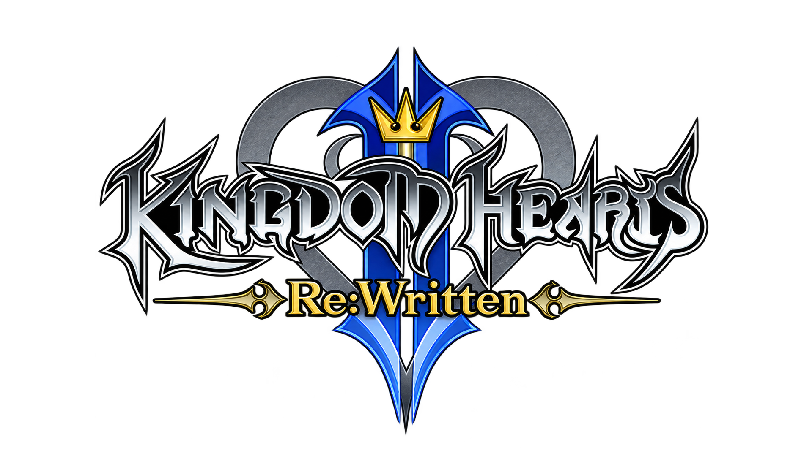

# Kingdom Hearts II Re:Written

<p align="center">
  
</p>

A native Windows engine rewrite of **Kingdom Hearts II Final Mix** in Rust, using [Bevy](https://bevy.org). It reads your own Steam installation at runtime. No game assets are distributed.

> **Status: very early.** All worlds playable and explorable and works as a sandbox.

> **DISCLAIMER:** If you haven't noticed, this is entirely vibecoded using Claude AI. If you do not like it then you can simply move on with your life.

## What works

- Sora walks, runs, jumps, lands and attacks with his own animations and Kingdom Key, in a Twilight Town room.
- Movement numbers are read from Sora's installed parameter records. Some values, such as gravity and body size, are still test-room choices, so the room is not an exact copy of the game.
- Enemies, damage, sound, saves and the rest of the campaign are not implemented.

For scope and progress, see the [fidelity contract](docs/fidelity-contract.md), [milestones](docs/milestones.md) and [unknowns](docs/unknowns.md).

<!-- KH2FM-PROGRESS:START -->
### Verified progress

| Measure | Accepted / tracked | Percentage |
|---|---:|---:|
| Complete functions decompiled and checked | 0 / 186 (inventory incomplete) | Unmeasured |
| Required behavior scenarios verified 1:1 | 0 / 7 (inventory incomplete) | Unmeasured |
| Final roadmap gates accepted | 0 / 32 | 0.00% |

Whole-game 1:1 coverage is **unmeasured** until the complete function and behavior inventories are qualified. Partial work, synthetic tests and successful builds do not count as 1:1 passes. Gate percentage measures accepted gates, not game size or implementation effort.

[Progress details](docs/progress/README.md) · [Coverage ledger](docs/progress/coverage.json) · [Automatic updates](.github/workflows/progress.yml)
<!-- KH2FM-PROGRESS:END -->

## Find your way around

Start with the [folder guide](docs/folder-guide.md) for common edits and naming rules.
`source/game/` holds gameplay, `source/visual/` holds rendering and menus, `source/visual/effect/` runs effects,
and `source/main/` holds the launcher and application. `source/data/` reads game formats,
`validation/` validates the installation, and `source/audio/` handles sound output.
Each main folder has a short README. See [ARCHITECTURE.md](ARCHITECTURE.md)
for package boundaries and current limitations.

## Quick start

You need Windows, your own **legally obtained** Steam copy of Kingdom Hearts HD 1.5 + 2.5 ReMIX, and the pinned Rust toolchain. See [CONTRIBUTING.md](CONTRIBUTING.md#setup).

```powershell
powershell -NoProfile -File tools/Build-Launcher.ps1
& '.\target\release\KH2RW Launcher.exe'
```

The first launch opens a short quick start guide (F1 in the launcher brings it back). The launcher then finds your Steam install (or lets you browse to it), checks that it is a supported build, makes the test configs from your installed files, and offers the title screen and test room. Each launch re-checks your files.

Command-line runs also work:

```powershell
cargo run -p main --bin KH2RW --locked -- room '<selected-install-root>' '<private-directory>/source-manifest.json' '<private-directory>/test-room.json'
```

`title` and `talk` take the same arguments with their own configuration. The configuration format is in [T056](docs/tasks/T056-playable-test-room.md).

## Controls

| Action | Keyboard | Controller |
|---|---|---|
| Move | WASD | Left stick |
| Walk | Hold Left Alt | Tilt the stick slightly |
| Camera | Mouse | Right stick |
| Lock on / release | R | RB |
| Cycle locked target | | Hold RT and tilt right stick left/right |
| Attack | Enter, left click | A |
| Jump | Space | B |
| Guard | Right Shift, right click | X |
| Talk | F | Y |
| Shortcuts | Hold Left Shift | LB |
| Skateboard (needs the Skate 3 ISO) | J | |
| Collision overlay | F1 | |
| Debug options, summons and Scan | F3 | |
| Leave the test | Esc | |

In the generated arena, F3 → Summon enemies → Summoned actors lets you enable
AI and combat for ordinary Shadow, Dusk and Soldier. Other enemies currently
support animation inspection. F3's Scan option toggles the learned ability;
equipping it shows the selected enemy's live HP in the original Scan gauge at the
top right. While locked on, the camera follows the original lock-on camera
(right stick still turns and zooms it). The lock-on reticle sprite is not drawn
yet. Full roster combat and installed-game comparisons remain unfinished.

## Build and check

`build-release.bat` builds the optimized launcher and its two viewers;
`build-debug.bat` makes the faster development build. The `-skate3` variants
(`build-release-skate3.bat`, `build-debug-skate3.bat`) enable the `skate3`
feature. Add `-LauncherOnly` when the viewers are already built. Compact development symbols and Rust's bundled
LLVM linker reduce build-output overhead; see
[local build options and cleanup](CONTRIBUTING.md#local-builds-and-disk-use).

```powershell
cargo build --workspace --locked
cargo test --workspace --locked
cargo run -p main --locked -- --frames 180
```

### Native Linux development

The first native Linux build and **source-free development window** work on the
current x86_64 Wayland host. Run `cargo run -p main --locked -- --frames 180`
from a Wayland session. This shows a generated sample, not the game, and needs no
installation or saves. The pinned dependencies are unchanged; Linux now selects
the Wayland backend explicitly. See [the build/startup record](docs/tasks/T177_linux_build_startup.md)
for checks and remaining limits.

The launcher (`cargo run -p main --bin KH2RW --locked`) also opens natively on
Wayland, with bundled fonts, Linux folders, native folder browsing and Linux
Steam library detection ([T178](docs/tasks/T178_linux_launcher_boundary.md)).
Sound plays through the existing mixer to the Linux sound system (ALSA,
usually PipeWire's bridge) at the mixer's own 48 kHz stereo
([T179](docs/tasks/T179_linux_sound_output.md)).

The launcher also accepts the current Epic copy, whose packages sit in
`Image/en` rather than Steam's `Image/dt`: browse to its folder
([T180](docs/tasks/T180_epic_source_binding.md)). From it the title, test rooms
and cutscene start on Linux. **Saving is off for an Epic copy**: its save format
is not qualified, so no save file is read or written, the title warns, and its
window title says SAVING OFF. Installed-source gameplay is not yet qualified on
Linux. Epic and Steam source candidates remain quarantined; a successful build,
launcher window or Epic run does not admit either one. Windows runtime regression checks also remain
outstanding. This is not a release or a claim of distro, controller or
whole-game support.

The full list of checks, and the rules for contributing, are in [CONTRIBUTING.md](CONTRIBUTING.md). Developer tools for reading the installed game are in [docs/developer-tools.md](docs/developer-tools.md).

## Private data

Source manifests, package records, captures and saves stay outside this repository.
The Windows layout uses `%LOCALAPPDATA%\KH2FinalRewrite\`; see [ARCHITECTURE.md](ARCHITECTURE.md).

On Linux each kind of file has its own `KH2FinalRewrite` folder, following the
XDG base-directory rules (absolute `$XDG_*` values, else the `$HOME` defaults;
relative values are ignored):

| What | Folder |
|---|---|
| Launcher settings | `$XDG_CONFIG_HOME` (`~/.config`) |
| Source manifests, generated test configs, launch files, saved start rooms | `$XDG_DATA_HOME` (`~/.local/share`) |
| Logs (viewers, smoke) | `$XDG_STATE_HOME/…/logs` (`~/.local/state`) |

There is no checkout or working-directory fallback on Linux, and nothing is
migrated from Windows. The smoke's `--log '<private-file>'` overrides its log
location without requiring either variable.

## Credits

- **Project owner:** TheGlurbus ([@BurBaGlurbus](https://github.com/BurBaGlurbus)), who maintains the project.
- **Code:** written with [Claude](https://claude.com/claude-code), an AI coding assistant, under the owner's direction.
- **Format research:** [OpenKH](https://git.openkh.dev/) (Apache-2.0) documents the game's file formats, and the project's reader follows it. The attribution list is in [NOTICE](NOTICE).
- **Other third-party code:** [Bevy](https://bevy.org), the `image` and `png` crates, zlib-rs, Microsoft DirectXTex (MIT), the .NET runtime (MIT), and `bevy_mikktspace` (Morten Mikkelsen). Off Windows the launcher's text uses the bundled Liberation Sans fonts (SIL OFL 1.1; see [their notes](source/main/assets/fonts/README.md)). Release licences are in [docs/release/](docs/release/).
- **Skate 3 crates** (`source/extras/skateboard/engine/`, GPL-3.0): adapted from [SK8-ENGINE/skate-3-rust-engine](https://github.com/SK8-ENGINE/skate-3-rust-engine). See [its README](source/extras/skateboard/engine/README.md).
- **Games:** *Kingdom Hearts* is by Square Enix and Disney. This project is not affiliated with or endorsed by either company.

## License

Apache-2.0, see [LICENSE](LICENSE). Third-party licences are listed in [NOTICE](NOTICE).
