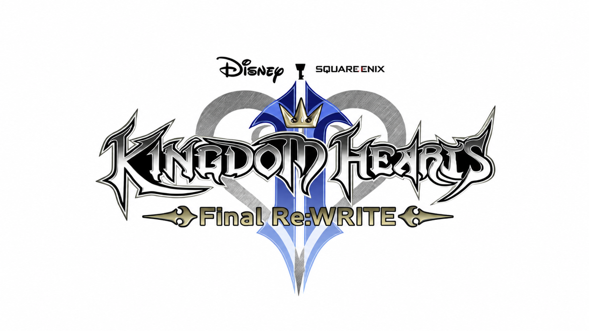

# Kingdom Hearts II Re:Written

<p align="center">
  
</p>

A native Windows rewrite of **Kingdom Hearts II Final Mix** in Rust, using [Bevy](https://bevy.org). It reads your own Steam installation at runtime. No game assets are distributed.

> **Status: early.** A playable test room runs. The rest of the game does not work yet.

## What works

- Sora walks, runs, jumps, lands and attacks with his own animations and Kingdom Key, in a Twilight Town room.
- Movement numbers are read from Sora's installed parameter records. Some values, such as gravity and body size, are still test-room choices, so the room is not an exact copy of the game.
- Enemies, damage, sound, saves and the rest of the campaign are not implemented.

For scope and progress, see the [fidelity contract](docs/fidelity-contract.md), [milestones](docs/milestones.md) and [unknowns](docs/unknowns.md).

## Quick start

You need Windows, your own Steam copy of KH2 Final Mix, and the pinned Rust toolchain. See [CONTRIBUTING.md](CONTRIBUTING.md#setup).

```powershell
cargo build --release -p windows_shell --bin kh2fm --locked
target\release\kh2fm.exe
```

The first launch opens a short quick start guide (F1 in the launcher brings it back). The launcher then finds your Steam install (or lets you browse to it), checks that it is a supported build, makes the test configs from your installed files, and offers the title screen and test room. Each launch re-checks your files.

Command-line runs also work:

```powershell
cargo run -p windows_shell --bin kh2fm --locked -- room '<selected-install-root>' '<private-directory>/source-manifest.json' '<private-directory>/test-room.json'
```

`title` and `talk` take the same arguments with their own configuration. The configuration format is in [T056](docs/tasks/T056-playable-test-room.md).

## Controls

| Action | Keyboard | Controller |
|---|---|---|
| Move | WASD | Left stick |
| Walk | Hold Left Alt | Tilt the stick slightly |
| Camera | Mouse | Right stick |
| Attack | Enter, left click | A |
| Jump | Space | B |
| Guard | Right Shift, right click | X |
| Talk | F | Y |
| Shortcuts | Hold Left Shift | LB |
| Skateboard (needs the Skate 3 ISO) | J | |
| Collision overlay | F1 | |
| Leave the test | Esc | |

## Build and check

```powershell
cargo build --workspace --locked
cargo test --workspace --locked
cargo run -p windows_shell --locked -- --frames 180
```

The full list of checks, and the rules for contributing, are in [CONTRIBUTING.md](CONTRIBUTING.md). Developer tools for reading the installed game are in [docs/developer-tools.md](docs/developer-tools.md).

## Private data

Source manifests, package records, captures and saves stay outside this repository, in `%LOCALAPPDATA%\KH2FinalRewrite\`. See [ARCHITECTURE.md](ARCHITECTURE.md) for the layout.

## Credits

- **Project owner:** TheGlurbus ([@BurBaGlurbus](https://github.com/BurBaGlurbus)), who maintains the project.
- **Code:** written with [Claude](https://claude.com/claude-code), an AI coding assistant, under the owner's direction.
- **Format research:** [OpenKH](https://git.openkh.dev/) (Apache-2.0) documents the game's file formats, and the project's reader follows it. The attribution list is in [NOTICE](NOTICE).
- **Other third-party code:** [Bevy](https://bevy.org), the `image` and `png` crates, zlib-rs, Microsoft DirectXTex (MIT), the .NET runtime (MIT), and `bevy_mikktspace` (Morten Mikkelsen). Release licences are in [docs/release/](docs/release/).
- **Skate 3 crates** (`crates/skate3/`, GPL-3.0): adapted from [SK8-ENGINE/skate-3-rust-engine](https://github.com/SK8-ENGINE/skate-3-rust-engine). See [its README](crates/skate3/README.md).
- **Games:** *Kingdom Hearts* is by Square Enix and Disney. This project is not affiliated with or endorsed by either company.

## License

Apache-2.0, see [LICENSE](LICENSE). Third-party licences are listed in [NOTICE](NOTICE).
